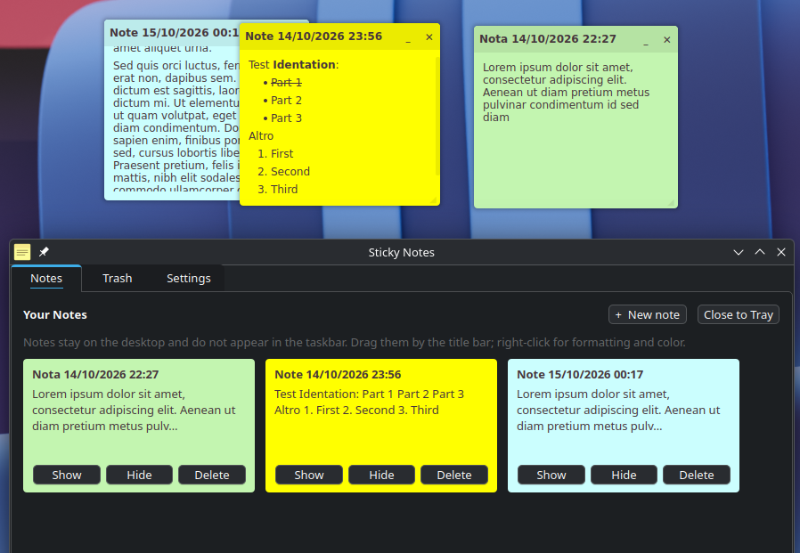
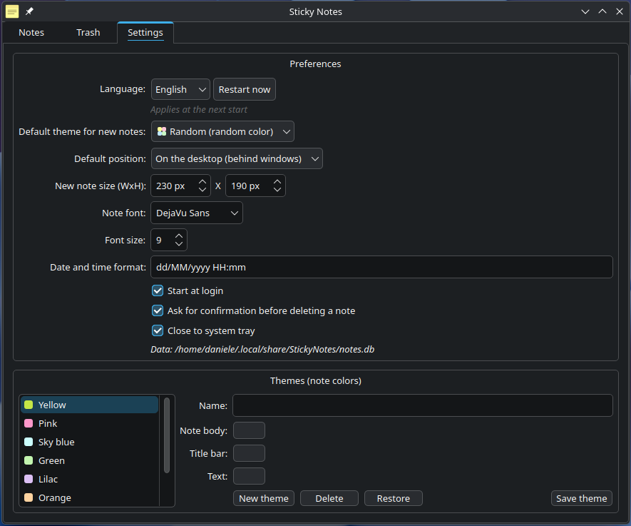

# Sticky Notes

Desktop sticky notes for **KDE Plasma (Wayland)**. The notes are **layer-shell
surfaces**: no decorations, **outside the taskbar** and **outside Alt+Tab**,
freely positionable on the desktop. An icon in the taskbar opens the **hub** with
the note grid, trash and settings.



---

## Features

### Notes
- **Layer-shell surfaces**: no decorations, outside the taskbar and Alt+Tab by
  definition, position chosen by the app.
- **Title bar** with editable title (double click) and drag grip. It is dragged
  **only from the title bar**, smoothly and 1:1 with the mouse.
- **Resizing** from the bottom-right corner.
- **Formatting** from the right-click menu: bold, italic, underline,
  strikethrough, bulleted list, numbered list, clear formatting.
- Content saved as **Markdown** (Qt `QTextDocument::toMarkdown()`).
- **Color/theme per note** (post-it palette) from the context menu.
- **Always on top** (*top* layer) or **on the desktop** (*bottom* layer), per
  single note. The note that has **focus** stays in front of the other windows
  anyway; a *desktop* note goes back under only when focus moves elsewhere.
- Configurable font (default **DejaVu Sans**).

### Hub (taskbar icon)
- **Notes**: grid of cards with color, title and preview; Open / Show-Hide /
  Delete actions; *New note* button.
- **Trash**: restore, permanent delete, empty.
- **Settings**: default theme and position, font and size, autostart, delete
  confirmation, data path, **theme editor** with color picker (body, title bar,
  text).



### System
- Local **SQLite** (`~/.local/share/StickyNotes/notes.db`) for notes, themes,
  settings.
- **Single instance**: a second launch does not open a copy but brings the hub to
  the front.
- Optional **autostart** (`~/.config/autostart/sticky-notes.desktop`): at login only
  the notes appear on the desktop, the hub stays out of the way (in the tray when
  *close to system tray* is active, otherwise minimized).
- Closing the hub (X) quits the app, like **Quit app**: the notes are saved and
  reappear at the next launch.
- Optional **close to system tray**: when enabled, closing the hub (X or *Quit
  app*) keeps Sticky Notes running with a tray icon (*Show window* / *Quit app*).

### Languages
- UI in **English** (source and default) or **Italian**, selected in the settings
  (*System*, *English*, *Italiano*). The change applies at the **next start**: the
  selector offers a *Restart now* button.
- Strings use **symbolic keys** (`I18n::t("settings.title")`); `en.json` is always
  installed as the base, so a missing key falls back to English.

---

## Requirements

- **Qt6**: Core, Gui, Widgets, Sql, Network
- **LayerShellQt** (KDE) — the compositor must implement
  `wlr-layer-shell-unstable-v1` (**KWin** since Plasma 6.6, wlroots, …)
- **Wayland session** (on X11 there is no layer-shell)
- To build: CMake ≥ 3.20, C++17 compiler, Ninja

openSUSE Tumbleweed:

```bash
sudo zypper install layer-shell-qt6-devel qt6-base-devel qt6-wayland-devel \
                    cmake ninja gcc-c++
```

> **GNOME is not supported**: Mutter does not implement the layer-shell protocol.
> This project is intentionally designed for KDE Plasma.

---

## Building

```bash
cmake -B build -G Ninja -DCMAKE_BUILD_TYPE=Release
cmake --build build
```

## Running

```bash
./build/sticky-notes
```

The app must run on the **wayland** QPA; to force it:

```bash
QT_QPA_PLATFORM=wayland ./build/sticky-notes
```

To see the logs (Qt suppresses them when stderr is not a terminal):

```bash
QT_FORCE_STDERR_LOGGING=1 QT_QPA_PLATFORM=wayland ./build/sticky-notes
```

## Installing (per user)

```bash
./packaging/install.sh          # into ~/.local  (PREFIX=... to change it)
```

It installs the binary, the menu entry and the icon, so the app shows up in the
KDE menu and the icon is correct in the taskbar. To remove:

```bash
rm -f ~/.local/bin/sticky-notes \
      ~/.local/share/applications/sticky-notes.desktop \
      ~/.local/share/icons/hicolor/256x256/apps/sticky-notes.png
```

---

## Usage

| Action | How |
|---|---|
| Move a note | drag from the **title bar** |
| Resize | drag the **bottom-right** corner |
| Edit the title | **double click** on the title bar (Enter/Esc to confirm) |
| Format the text | **right click** in the body → Bold / Italic / … / lists |
| Change color | right click → **Note color** |
| Above/below windows | right click → **Always on top** |
| New / duplicate / hide / delete | right click on the note |
| Open the hub | click the app icon in the taskbar (or relaunch the app) |
| Quit | hub → **Quit app** (or the window **X**) |

---

## Data and schema

Path: `~/.local/share/StickyNotes/notes.db` (SQLite).

| Table | Main columns |
|---|---|
| `notes` | `id, title, content (Markdown), theme, x, y, w, h, layer, visible, deleted, created_at, updated_at, deleted_at` |
| `themes` | `id, name, body, title_bar, text_color, sort, builtin` |
| `settings` | `key, value` |

Settings keys: `default_theme`, `default_layer`, `font_family`, `font_size`,
`date_format`, `autostart`, `confirm_delete`, `language`.

Deleting a note moves it to the **trash** (`deleted = 1`); permanent deletion
removes the row.

To start from scratch:

```bash
rm ~/.local/share/StickyNotes/notes.db
```

---

## Architecture

```
src/Models.h          Note and Theme structures
src/Storage.*         SQLite: notes, themes, settings
src/Themes.*          default post-it palette
src/I18n.*            runtime translations (symbolic keys + JSON per language, English fallback)
src/NoteWindow.*      layer-shell note window (title, Markdown, menu, drag/resize)
src/HubWindow.*       hub: grid, trash, settings, theme editor
src/AppController.*   orchestration, single instance, autostart
resources/i18n/       translations (en.json, it.json)
resources/icons/      app icon
packaging/            .desktop and install script
docs/                 screenshot and technical notes
```

---

## Adding a language

Translations are one JSON file per language under `resources/i18n/`, embedded in
the binary as Qt resources (`:/i18n/<code>.json`). Keys are **symbolic,
lowercase, dot-grouped identifiers** (`"settings.title"`, `"note.delete"`, …) and
values are **plain text with no HTML** (bold/italic are applied in C++ with
`QFont`). Drop `resources/i18n/xx.json` with a `_meta` object
(`{"code": "xx", "name": "<native name>"}`) plus the translated values and
rebuild. `en.json` is always installed as the **base translator** and the selected
language on top of it, so a missing key falls back to English. The JSON is
**embedded in the binary**, so there is nothing extra to ship (it works with
AppImage/Flatpak too).

## Technical notesk

- On Wayland a normal window **cannot** choose its own position nor exclude
  itself from the taskbar. **Layer-shell** surfaces do so by definition.
- Dragging uses the **local** coordinate of the surface in an **incremental**
  form: `globalPosition()` is synthesized by Qt and, used in absolute form, makes
  the window oscillate (half the distance, jumps).
- Dragging is protected against the **loss of the button release** and the
  position is always clamped to the screens, so a note cannot end up unreachable.
- The note that has **focus** moves to the *top* layer: a *desktop* note stays in
  front (and therefore editable) while it has focus, then goes back under.

## Known limitations

- **KDE/Wayland only** with layer-shell support; GNOME and X11 sessions are not
  supported.
- **Multi-monitor**: notes are anchored to the top-left edge of the screen chosen
  by the compositor; moving between monitors is not handled yet.
- **Order (z-order)** among notes of the same layer is not controllable by the
  client.
- **Distribution**: AppImage and Flatpak are missing (the user install script is
  ready).
- **Tray** icon: provided by the *close to system tray* option (off by default;
  the taskbar icon is used otherwise).
- Keyboard shortcuts in the note body not present yet.
- With the app not installed a harmless XDG portal warning appears
  (`App info not found for 'sticky-notes'`): it disappears after
  `packaging/install.sh`.

## Licenses

Project code: see the repository. Dependencies used at runtime:
Qt6 (LGPLv3 / GPL), LayerShellQt (LGPL-2.1-or-later), SQLite (public domain).
To distribute the binaries the terms of the respective licenses must be respected.
