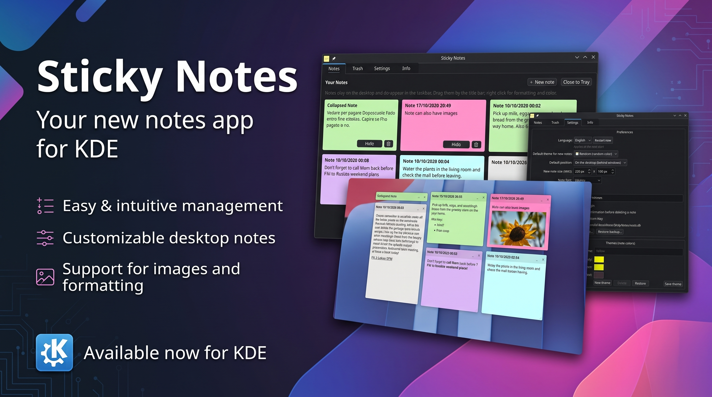
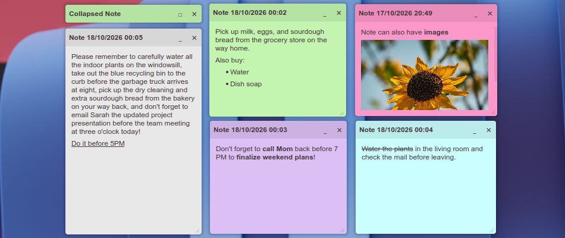
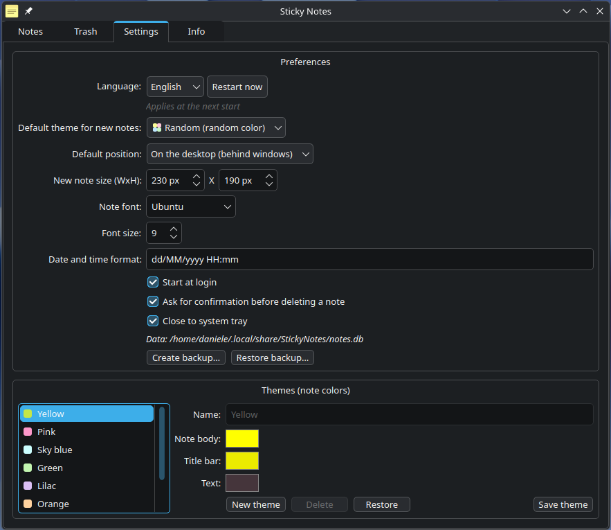

# Sticky Notes

Desktop sticky notes for **KDE Plasma (Wayland)**.


## Try it!

Download the latest release from the [Releases page](https://github.com/danielearrighi/kde-sticky-notes/releases).
There are two ways to try it.

**AppImage** (self-contained, bundles Qt6 and LayerShellQt — nothing to build):
download `sticky-notes-<version>-x86_64.AppImage`, make it executable and run it:

```bash
chmod +x sticky-notes-<version>-x86_64.AppImage
./sticky-notes-<version>-x86_64.AppImage
```
or 

**tar.gz** (plain binary release — installs it in your session, so it shows up
in the KDE menu and the taskbar): download `sticky-notes-<version>-x86_64.tar.gz`, extract it and run the bundled installer:

```bash
tar -xzf sticky-notes-<version>-x86_64.tar.gz
cd sticky-notes-<version>-x86_64
./install.sh
```

The installer checks the runtime libraries, offers to install the missing ones with your package manager and copies the app into `~/.local`. Run it with `--help` for the options, and run `sticky-notes` (or the KDE menu entry) afterwards to start it.

## Build

You need a **KDE Plasma (Wayland)** session with layer-shell support (KWin since
Plasma 6.6) and the Qt6 + LayerShellQt development packages.

Then build and run it from the source tree:

```bash
cmake -B build -G Ninja -DCMAKE_BUILD_TYPE=Release
cmake --build build
./build/sticky-notes
```

The app must run on the **wayland** QPA; to force it (and see the logs, which Qt
suppresses when stderr is not a terminal):

```bash
QT_QPA_PLATFORM=wayland QT_FORCE_STDERR_LOGGING=1 ./build/sticky-notes
```

> **Not on KDE?** GNOME (Mutter) and X11 sessions do not implement the
> layer-shell protocol, so the app cannot run there. It is intentionally designed
> for KDE Plasma.

## Install

Install for the current user (binary, menu entry and icon, so it shows up in the
KDE menu and the taskbar):

```bash
./packaging/install.sh          # into ~/.local  (PREFIX=... to change it)
```

To remove it:

```bash
rm -f ~/.local/bin/sticky-notes \
      ~/.local/share/applications/sticky-notes.desktop \
      ~/.local/share/icons/hicolor/256x256/apps/sticky-notes.png
```

---

## What you can do



- **Move and resize notes** — drag from the title bar, resize from the
  bottom-right corner.
- **Markdown content** — write freely and format it (bold, italic, underline,
  strikethrough, lists) from the right-click menu.
- **Theming** — pick a color/theme per note, configure a default theme and font,
  and build your own themes with the color picker in the settings.
- **Always on top or on the desktop** — per note, from the context menu.
- **Manage notes from the hub** — the taskbar icon opens a grid of notes (open,
  hide, delete, new) plus a **trash** and the **settings**, where you can also
  back up and restore your notes.
- **Info** — Qt/libraries versions, the data path and the author.
- **Autostart and tray** — start the notes at login; optionally keep the app
  running in the system tray when the hub is closed.
- **Single instance** — launching the app again just brings the hub to the front.
- **Languages** — Multilanguage (only English, Italian for now)



---

## Data

Path: `~/.local/share/StickyNotes/notes.db` (SQLite).

To start from scratch:

```bash
rm ~/.local/share/StickyNotes/notes.db
```

---

## Adding a language

Translations are one JSON file per language under `resources/i18n/`, embedded in
the binary as Qt resources (`:/i18n/<code>.json`). Keys are **symbolic,
lowercase, dot-grouped identifiers** (`"settings.title"`, `"note.delete"`, …) and
values are **plain text with no HTML** (bold/italic are applied in C++ with
`QFont`). Drop `resources/i18n/xx.json` with a `_meta` object
(`{"code": "xx", "name": "<native name>"}`) plus the translated values and
rebuild.

## Technical notes

- On Wayland a normal window **cannot** choose its own position nor exclude
  itself from the taskbar. **Layer-shell** surfaces do so by definition.
- Dragging uses the **local** coordinate of the surface in an **incremental**
  form: `globalPosition()` is synthesized by Qt and, used in absolute form, makes
  the window oscillate (half the distance, jumps).
- Dragging is protected against the **loss of the button release** and the
  position is always clamped to the screens, so a note cannot end up unreachable.
- The note that has **focus** moves to the *top* layer: a *desktop* note stays in
  front (and therefore editable) while it has focus, then goes back under.

## Known limitations/Not Tested

- **KDE/Wayland only** with layer-shell support; GNOME and X11 sessions are not
  supported.
- **Order (z-order)** among notes of the same layer is not controllable by the
  client.

## Licenses

Project code is licensed under the **GNU General Public License v3.0 or later**
(GPL-3.0-or-later). Dependencies used at runtime:
Qt6 (LGPLv3 / GPL), LayerShellQt (LGPL-2.1-or-later), SQLite (public domain).
To distribute the binaries the terms of the respective licenses must be respected.
