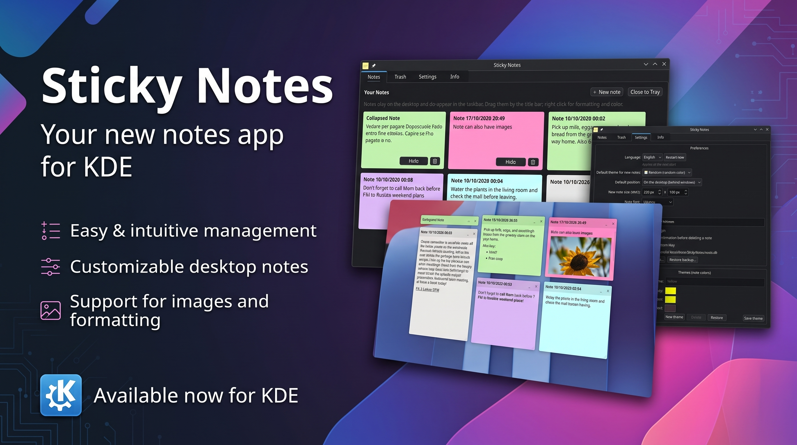
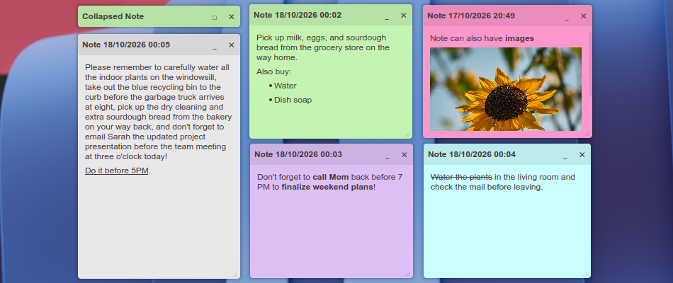
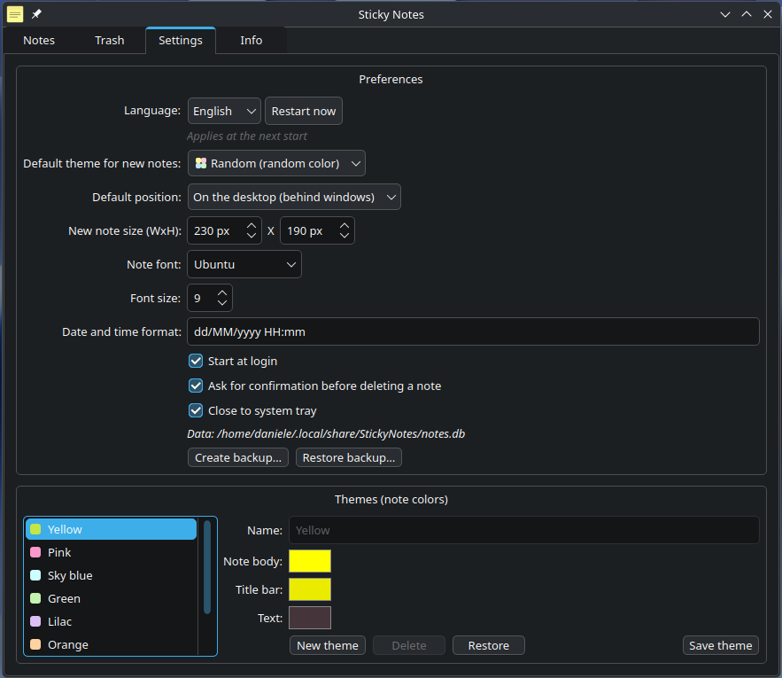

# KDE Sticky Notes

Desktop sticky notes for **KDE Plasma (Wayland)**.


## Try it!

Download the latest release from the [Releases page](https://github.com/danielearrighi/kde-sticky-notes/releases).
There are five ways to try it. The tarball, AppImage and Flatpak are published
for **x86_64** and **aarch64**; the .deb and .rpm packages are **x86_64 only**.
In the file names below `<arch>` is the one matching `uname -m`.

**Flatpak** (bundles Qt 6.10 and LayerShellQt in the `org.kde.Platform`
runtime, so it does not depend on the distribution or on the Qt version
installed): download `sticky-notes-<version>-<arch>.flatpak` and install it:

```bash
flatpak install --user ./sticky-notes-<version>-<arch>.flatpak
flatpak run io.github.danielearrighi.StickyNotes
```

Flatpak downloads the KDE runtime automatically on install. If the app is
installed from a repository (for example Flathub) update it with
`flatpak update io.github.danielearrighi.StickyNotes`; for a downloaded
`.flatpak` use the newer file:

```bash
flatpak install --user --reinstall ./sticky-notes-<new-version>-<arch>.flatpak
```

**AppImage** (self-contained, bundles Qt6 and LayerShellQt — nothing to build):
download `sticky-notes-<version>-<arch>.AppImage`, make it executable and run it:

```bash
chmod +x sticky-notes-<version>-<arch>.AppImage
./sticky-notes-<version>-<arch>.AppImage
```
or 

**tar.gz** (plain binary release — installs it in your session, so it shows up
in the KDE menu and the taskbar): download `sticky-notes-<version>-<arch>.tar.gz`, extract it and run the bundled installer:

```bash
tar -xzf sticky-notes-<version>-<arch>.tar.gz
cd sticky-notes-<version>-<arch>
./install.sh
```

The installer checks the runtime libraries, offers to install the missing ones with your package manager and copies the app into `~/.local`. Run it with `--help` for the options, and run `sticky-notes` (or the KDE menu entry) afterwards to start it.

**Debian/Ubuntu package (.deb, x86_64)**: download
`sticky-notes_<version>-1_amd64.deb` and install it system-wide:

```bash
sudo apt install ./sticky-notes_<version>-1_amd64.deb
```

It needs **Ubuntu 26.04+** or **Debian forky/sid+** with the system **Qt 6.10 +
LayerShellQt 6.6** or newer; on an older release apt refuses to install it (use
the AppImage or the Flatpak instead). Remove it with
`sudo apt remove sticky-notes`.

**Fedora/openSUSE package (.rpm, x86_64)**: download
`sticky-notes-<version>-1.x86_64.rpm` and install it:

```bash
sudo dnf install ./sticky-notes-<version>-1.x86_64.rpm     # Fedora 44+
sudo zypper install ./sticky-notes-<version>-1.x86_64.rpm  # openSUSE Tumbleweed
```

It uses the system Qt 6.10 + LayerShellQt 6.6 or newer. Remove it with
`sudo dnf remove sticky-notes` or `sudo zypper remove sticky-notes`.

> **Qt version:** the tar.gz, the .deb and the .rpm use the system Qt and are
> built against **Qt 6.10 + LayerShellQt 6.6** (the oldest versions the app
> supports); they run on any distribution with those or newer (Fedora 44,
> Tumbleweed, Ubuntu 26.04, Debian forky, ...). On an older Qt `install.sh`
> stops, and apt/dnf/zypper refuse to install the package: use the AppImage or
> the Flatpak, which bundle their own Qt.

## Build

You need a **KDE Plasma (Wayland)** session with layer-shell support (KWin since
Plasma 6.6) and the Qt6 + LayerShellQt development packages.

Then build and run it from the source tree:

```bash
cmake -B build -G Ninja -DCMAKE_BUILD_TYPE=Release
cmake --build build
./build/sticky-notes
```

The app must run on the **wayland** QPA; to force it (and see the logs, which Qt
suppresses when stderr is not a terminal):

```bash
QT_QPA_PLATFORM=wayland QT_FORCE_STDERR_LOGGING=1 ./build/sticky-notes
```

> **Not on KDE?** GNOME (Mutter) and X11 sessions do not implement the
> layer-shell protocol, so the app cannot run there. It is intentionally designed
> for KDE Plasma.

### Flatpak bundle

The manifest is `packaging/io.github.danielearrighi.StickyNotes.yml`. It builds
against `org.kde.Platform` / `org.kde.Sdk` **6.10** (Qt 6.10.3) and compiles
**LayerShellQt 6.6** because the KDE runtime does not ship it. The runtime is a
dependency of the app, not of the host, so the same bundle runs on Fedora 44,
Ubuntu, Debian and so on regardless of their Qt version:

```bash
flatpak install flathub org.kde.Sdk//6.10
./scripts/build_flatpak.sh            # release/sticky-notes-<version>-<arch>.flatpak
./scripts/build_flatpak.sh --install  # build and install it
```

`flatpak-builder` is needed; if it is missing, the script uses the
`org.flatpak.Builder` Flatpak app (`flatpak install flathub org.flatpak.Builder`).

### Distribution packages (.deb / .rpm)

The .deb and the .rpm package the same portable binary as the tarball (system Qt
6.10 + LayerShellQt 6.6). They are built in containers, so the host distribution
does not matter:

```bash
./scripts/build_deb.sh    # release/sticky-notes_<version>-1_amd64.deb
./scripts/build_rpm.sh    # release/sticky-notes-<version>-1.x86_64.rpm
```

`build_deb.sh` runs `dpkg-shlibdeps` in the Ubuntu 26.04 image and adds the
Wayland QPA plugin and the SQLite driver as dependencies; `build_rpm.sh` runs
`rpmbuild` in a Fedora 44 image and generates the Fedora/openSUSE rich
dependencies (Qt >= 6.10, LayerShellQt >= 6.6, QSQLITE). Both accept
`--skip-build` to repackage an existing `build-release-<arch>/sticky-notes`.
Only **x86_64** is published.

### Other architectures (aarch64)

Every build script accepts `--arch x86_64|aarch64` (default: the host one), the
artifacts are named `release/sticky-notes-<version>-<arch>.*` (or the Debian/RPM
conventions above), and `scripts/build_all.sh` builds both architectures and all
five artifacts in one go:

```bash
./scripts/build_all.sh                  # x86_64 + aarch64: tarball, AppImage, Flatpak, deb, rpm
./scripts/build_all.sh --archs x86_64   # host architecture only
./scripts/build_all.sh --only deb,rpm   # just the distribution packages
```

The .deb and .rpm are x86_64 only: `build_all.sh` skips them for the other
architecture. Building for the architecture you are not running needs QEMU user
emulation (`qemu-linux-user` on openSUSE, `qemu-user-static` on
Fedora/Debian/Ubuntu), and the Flatpak bundle needs the SDK of that architecture
(`flatpak install --arch=aarch64 flathub org.kde.Sdk//6.10`). The tarball, the
.deb and the AppImage are built in `scripts/container/ubuntu26.04.Dockerfile`,
with one container image per architecture; a native aarch64 machine needs nothing
special. The aarch64 AppImage is built against the container's Qt 6.10 instead
of the host Qt, because linuxdeploy, its Qt plugin and appimagetool only run on
the architecture they package.


## Install

The .deb and .rpm install the app system-wide (`/usr/bin`, menu entry and icons)
with apt, dnf or zypper, as shown in *Try it!*. To remove them use the same
package manager.

For a per-user install from this source tree (binary, menu entry and icon, so it
shows up in the KDE menu and the taskbar):

```bash
./scripts/install.sh            # into ~/.local  (PREFIX=... to change it)
```

To remove it:

```bash
rm -f ~/.local/bin/sticky-notes \
      ~/.local/share/applications/sticky-notes.desktop \
      ~/.local/share/icons/hicolor/256x256/apps/sticky-notes.png
```

## Updates

Sticky Notes checks GitHub for a new release **at most once a day** while it is
running (the check is done at startup and when the hub is opened; it can be
turned off in *Settings*), and the **Info** tab has a *Check for updates*
button at any time. Nothing is downloaded without asking: the prompt offers
*Download and install*, and the download is verified against the release
`SHA256SUMS` before replacing anything.

- **AppImage** — the file you launched is replaced in place and the app
  restarts itself. The whole AppImage is downloaded (about 70 MB; delta updates
  are not implemented yet).
- **tar.gz install** — if you installed with the bundled `install.sh` into
  `~/.local`, the new tarball is extracted and `~/.local/bin/sticky-notes` is
  replaced. The `.desktop` entry and the icon are unchanged.
- **Flatpak** — managed by Flatpak: update with
  `flatpak update io.github.danielearrighi.StickyNotes` when it comes from a
  repository, or reinstall the newer `.flatpak` bundle. Inside the sandbox
  `/app` is read-only, so the automatic daily check is skipped and the
  *Check for updates* button only reports the new version.
- **Development builds** (`build/sticky-notes`) and **system packages** (the
  .deb/.rpm in `/usr/bin`, managed by apt/dnf/zypper) cannot update themselves:
  update them with the package manager, the dialog only links to the release
  page.

The previous file is kept as `sticky-notes.old` until the next successful
start, so a broken update can be recovered by hand.

---

## What you can do



- **Move and resize notes** — drag from the title bar, resize from the
  bottom-right corner.
- **Markdown content** — write freely and format it (bold, italic, underline,
  strikethrough, inline code, code blocks, lists) from the right-click menu.
- **Theming** — pick a color/theme per note, configure a default theme and font,
  and build your own themes with the color picker in the settings.
- **Always on top or on the desktop** — per note, from the context menu.
- **Opacity** — fade each note from 100% down to 10%, per note, from the context menu.
- **Show Desktop** — notes stay visible when you press Super+D, like desktop
  widgets; the behavior can be turned off in the settings.
- **Manage notes from the hub** — the taskbar icon opens a grid of notes (open,
  hide, delete, new) plus a **trash** and the **settings**, where you can also
  back up and restore your notes.
- **Info** — Qt/libraries versions, the data path, the author and the update
  check (a new version can be downloaded and installed from there).
- **Autostart and tray** — start the notes at login; optionally keep the app
  running in the system tray when the hub is closed, and pick the tray icon
  (automatic, colored or a custom image).
- **Single instance** — launching the app again just brings the hub to the front.
- **Languages** — English, Italian, Spanish and French



---

## Data

Path (tarball/AppImage install): `~/.local/share/StickyNotes/notes.db` (SQLite).
The Flatpak stores its notes in the sandbox:
`~/.var/app/io.github.danielearrighi.StickyNotes/data/StickyNotes/notes.db`.
A Flatpak install does not see the database of a tarball/AppImage install: to
move notes, create a backup from the old installation and restore it from the
Flatpak's *Settings* tab.

To start from scratch:

```bash
rm ~/.local/share/StickyNotes/notes.db
# Flatpak:
rm ~/.var/app/io.github.danielearrighi.StickyNotes/data/StickyNotes/notes.db
```

---

## Adding a language

Translations are one JSON file per language under `resources/i18n/`, embedded in
the binary as Qt resources (`:/i18n/<code>.json`). Keys are **symbolic,
lowercase, dot-grouped identifiers** (`"settings.title"`, `"note.delete"`, …) and
values are **plain text with no HTML** (bold/italic are applied in C++ with
`QFont`). Drop `resources/i18n/xx.json` with a `_meta` object
(`{"code": "xx", "name": "<native name>"}`) plus the translated values and
rebuild.

## Technical notes

- On Wayland a normal window **cannot** choose its own position nor exclude
  itself from the taskbar. **Layer-shell** surfaces do so by definition.
- Dragging uses the **local** coordinate of the surface in an **incremental**
  form: `globalPosition()` is synthesized by Qt and, used in absolute form, makes
  the window oscillate (half the distance, jumps).
- Dragging is protected against the **loss of the button release** and the
  position is always clamped to the screens, so a note cannot end up unreachable.
- The note that has **focus** moves to the *top* layer: a *desktop* note stays in
  front (and therefore editable) while it has focus, then goes back under.

## Known limitations/Not Tested

- **KDE/Wayland only** with layer-shell support; GNOME and X11 sessions are not
  supported.
- **Order (z-order)** among notes of the same layer is not controllable by the
  client.

## Licenses

Project code is licensed under the **GNU General Public License v3.0 or later**
(GPL-3.0-or-later). Dependencies used at runtime:
Qt6 (LGPLv3 / GPL), LayerShellQt (LGPL-2.1-or-later), SQLite (public domain).
To distribute the binaries the terms of the respective licenses must be respected.
